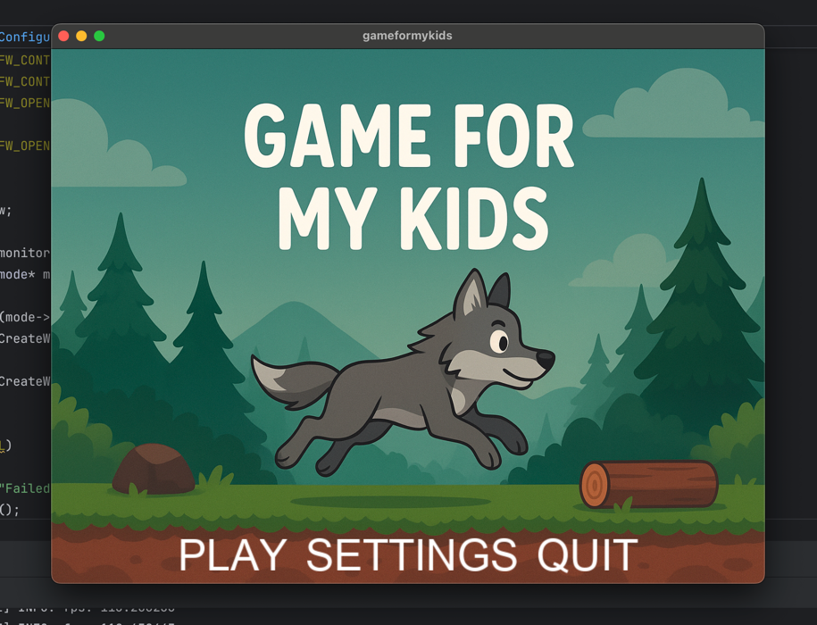
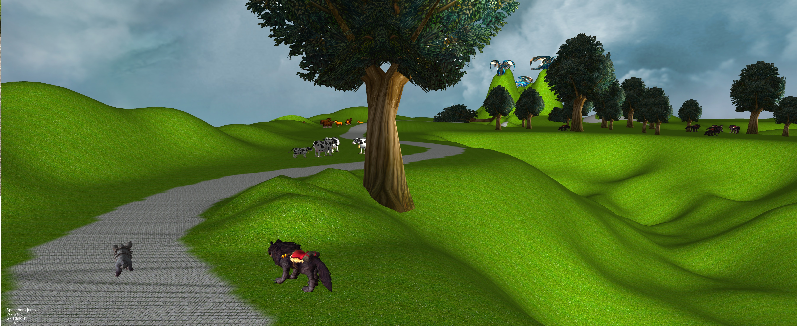

# gameformykids



I was always curious about how 3D games work and how are they created. To combine my **curiosity for game development** and **World of Warcraft lore**
with my kids possible future interest in games, I decided to create a simple game.

In the game a player (most likely kid) is moving on the terrain on the predefined path and observes the beautiful scenery that he builds. Yes! **The
player builds the scenery**. The game ships with game editor that allows modification of the terrain and placement of any World of Warcraft models (objects, species, animals, etc.) 

## Instalation

To install the game, these are the requirements:
- MacOS or Linux
- CMake
- wow.export (not a hard requirement but without it you won't be able to add any assets to the game)

### Guide

1) Pull the repository using any Terminal

```sh
# for http
git clone https://github.com/iNviNho/gameformykids.git
# for ssh
git clone git@github.com:iNviNho/gameformykids.git
```

2) Download the assets you want in the game using wow.export. Go to [wow.export website](https://www.kruithne.net/wow.export/) and download the program. Launch the program and 
either download a) `.obj` assets for static models or b) `.gLTF` for animated models.

3) Build and run the game using Terminal
```sh
./cli/build-and-run-local.sh
```
if it fails due to rights, make the script executable
```sh 
chmod +x ./cli/build-and-run-local.sh
```

4) Run the game and have fun :) 


I had a first quick run with my son and we came up with this within minutes :) 



## Feedback

If you enjoyed the game or liked the idea, give the game **a Star** - it will mean a world to me :)

If you want to see more features or stumbled upon a bug, go ahead and open an issue in the [Issues](https://github.com/iNviNho/gameformykids/issues) page. Once my life gets a bit simpler, I would love to continue :)

